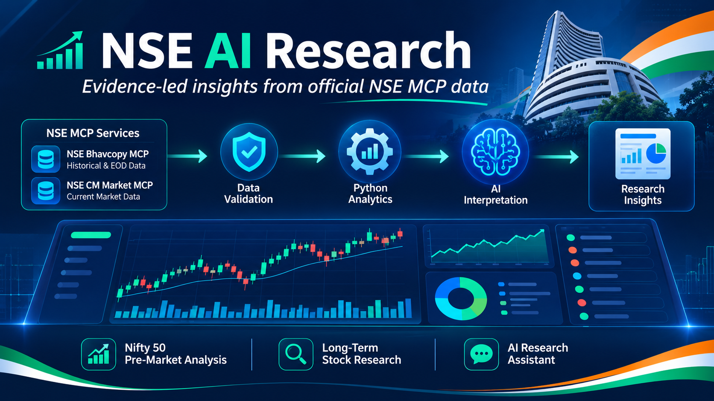
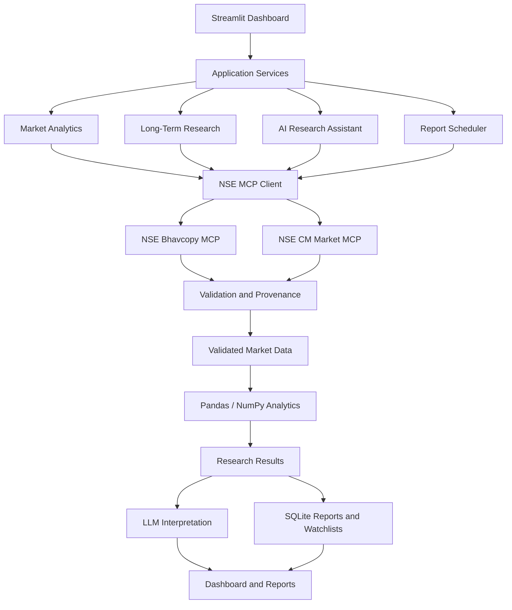

# NSE AI Research

> Evidence-led insights from official NSE MCP data.



An AI-powered Indian stock market research platform built with Python, Streamlit and the official National Stock Exchange (NSE) hosted Model Context Protocol (MCP) services.

**Core modules**
- **Nifty 50 Pre-Market Analysis** — evidence-based research using the latest available completed trading session.
- **Long-Term Stock Research** — historical performance, trend, relative strength, volatility, drawdown and volume analysis.
- **AI Research Assistant** — natural-language research grounded in validated NSE MCP responses and reproducible Python calculations.

The application connects to NSE-hosted MCP servers. It does **not** install or host an NSE MCP server locally.

## Important data principles

1. NSE MCP is the exclusive market-data source in the initial version.
2. No Yahoo Finance, `yfinance`, Google Finance, unofficial APIs, scraping or silent provider fallback.
3. The MCP tool catalogue is discovered at runtime. Tool names and input schemas are never assumed.
4. Missing or stale fields are reported as unavailable; market prices are never fabricated.
5. LLMs interpret validated data. They are not a source of prices or financial facts.
6. Historical market performance is not a measure of fundamental business quality and does not predict future returns.

> **NSE usage notice:** Review the current NSE MCP terms before development, storage, redistribution, commercial use or AI training. NSE's published MCP disclaimer describes the access as informational and restricts commercial exploitation and use for AI training/fine-tuning. This project is an independent third-party application and is not endorsed by NSE. See [NSE MCP](https://www.nseindia.com/nse-mcp).

## Architecture



### Data flow

**Actual NSE data → Validated market data → Python analytics → AI interpretation → Research output**

### Remote NSE MCP endpoints

| Server | Endpoint | Intended use |
|---|---|---|
| NSE Bhavcopy MCP | `https://mcp.nseindia.in/bhavcopy/cm/mcp` | Historical/EOD data and related analytics |
| NSE CM Market MCP | `https://mcp.nseindia.in/cmmkt/mcp` | Current market information; may be delayed |

The actual tools, descriptions and schemas are discovered dynamically. Capabilities listed by NSE may change; the discovered tool catalogue is the implementation authority.

## Repository layout

```text
nse-ai-research/
├── README.md
├── LICENSE
├── .gitignore
├── .env.example
├── pyproject.toml
├── requirements.txt
├── Dockerfile
├── docker-compose.yml
├── assets/
│   └── nse-ai-research-banner.png
├── .github/
│   ├── copilot-instructions.md
│   ├── ISSUE_TEMPLATE/feature_request.md
│   └── workflows/{tests.yml,lint.yml}
├── config/
│   ├── settings.yaml
│   ├── market_calendar.yaml
│   ├── nifty50_symbols.yaml
│   └── screening_rules.yaml
├── src/nse_research/
│   ├── core/
│   ├── data/{mcp,validators,repositories}/
│   ├── analytics/{nifty50,technical,screening}/
│   ├── research/{premarket,long_term,assistant}/
│   ├── scheduler/
│   ├── storage/
│   └── ui/{pages,components}/
├── tests/{unit,integration,fixtures/synthetic_data}/
├── scripts/
├── reports/.gitkeep
└── docs/
```

## Quick start

### Requirements

- Python 3.11+
- Git
- Internet access to the NSE MCP endpoints
- VS Code (recommended)

### 1. Clone and create a virtual environment

```bash
git clone https://github.com/YOUR_USERNAME/nse-ai-research.git
cd nse-ai-research

# Windows PowerShell
python -m venv .venv
.venv\Scripts\Activate.ps1

# macOS / Linux
python3 -m venv .venv
source .venv/bin/activate
```

### 2. Install

```bash
python -m pip install --upgrade pip
pip install -e ".[dev]"
```

### 3. Configure environment

```bash
# Windows PowerShell
Copy-Item .env.example .env

# macOS / Linux
cp .env.example .env
```

The NSE endpoints have defaults in the application. No NSE API key is configured by this starter. Add an LLM provider and key only if/when you implement an LLM adapter. Never commit `.env`.

### 4. Discover the actual NSE MCP tools

```bash
python scripts/discover_mcp_tools.py
python scripts/test_nse_connection.py
```

Discovery output is written to `docs/mcp_tool_catalogue.json` (ignored by Git by default because it may contain server-specific metadata; commit a reviewed, sanitized version to `docs/mcp_integration.md` if appropriate).

### 5. Run unit tests

```bash
pytest tests/unit -v
ruff check .
ruff format --check .
```

Live integration tests are opt-in and require network access:

```bash
RUN_NSE_INTEGRATION=1 pytest tests/integration -v
```

### 6. Launch the dashboard

```bash
streamlit run src/nse_research/ui/app.py
```

Open `http://localhost:8501`.

> The initial dashboard is a scaffold. It does not display fabricated market figures. Implement verified data workflows after reviewing the live MCP tool catalogue.

## Initial development sequence

| Phase | Work | Completion evidence |
|---|---|---|
| 1. Foundation | Configuration, logging, tests, project packaging | Local app and unit tests run |
| 2. NSE MCP | Connect to both endpoints, discover tools and schemas | Actual tool catalogue and successful live test |
| 3. Analytics | Breadth, movers, returns, moving averages, volatility, drawdown | Unit tests using clearly synthetic fixtures |
| 4. Pre-market | Trading calendar, 9:00 IST workflow, Markdown report | Report based on a completed NSE session |
| 5. Long-term research | Relative performance, risk, score and watchlists | Transparent score with data coverage |
| 6. AI assistant | Intent, tool routing, evidence context, response guard | Every market claim traceable to NSE data |
| 7. Dashboard | Overview, reports, research, screener, comparison, assistant | UI uses application services only |
| 8. Deployment | Docker, persistent storage, scheduler operations | Deployment and recovery checks |

Do not implement analytics against assumed MCP capabilities. Phase 2 must establish which data fields and operations are actually available.

## Data provenance and validation

Every retrieved record should preserve:
- MCP server and discovered tool name
- Tool input parameters
- Market/session date (when supplied by source)
- Application retrieval timestamp
- Validation status and validation warnings
- Calculation formula, period and timestamp for derived metrics

Market-data timestamp and retrieval timestamp are distinct. Missing data is not zero. Stale data is not current data. Synthetic fixtures are permitted for unit tests only and must never be represented as NSE observations.

## Long-term research score (configurable proposal)

| Component | Weight |
|---|---:|
| Long-term price trend | 25% |
| Relative performance | 20% |
| Historical volatility | 15% |
| Maximum drawdown | 15% |
| Volume consistency | 15% |
| 52-week price structure | 10% |
| **Total** | **100%** |

The score is a market-behaviour research aid, not a fundamental quality score or investment recommendation. Missing components are excluded from the weighted denominator and reported in coverage; they are not silently assigned zero or a favourable score.

## Important limitations

- CM Market data may be delayed by approximately 1–3 minutes and is not a tick-by-tick/order-book feed.
- At 9:00 AM IST, the pre-market report should use the latest completed session; do not assume a complete pre-open snapshot.
- NSE trading holidays and special sessions must be handled by a configurable, maintained calendar.
- Corporate actions can affect historical price comparisons.
- Revenue, profit, EPS, ROE, ROCE, debt, cash flow, valuation and promoter metrics remain unavailable unless explicitly verified in the discovered MCP catalogue or an approved future source.
- AI-generated research is informational, may be wrong and is not a guarantee of future performance or investment advice.

## GitHub Copilot

Project-specific guardrails are in [`.github/copilot-instructions.md`](.github/copilot-instructions.md). Use the staged prompts in [`docs/copilot_prompts.md`](docs/copilot_prompts.md) sequentially. Do not ask Copilot Agent to generate the whole application in one pass.

## Official references

- [NSE MCP documentation and terms](https://www.nseindia.com/nse-mcp)
- [NSE Bhavcopy MCP endpoint](https://mcp.nseindia.in/bhavcopy/cm/mcp)
- [NSE CM Market MCP endpoint](https://mcp.nseindia.in/cmmkt/mcp)
- [Model Context Protocol](https://modelcontextprotocol.io/)
- [Official MCP Python SDK](https://github.com/modelcontextprotocol/python-sdk)
- [Streamlit](https://docs.streamlit.io/)
- [Pandas](https://pandas.pydata.org/docs/)
- [NumPy](https://numpy.org/doc/)
- [Plotly](https://plotly.com/python/)
- [Pytest](https://docs.pytest.org/)

## Disclaimer

For research and educational use only. This software does not provide investment advice, execute trades or guarantee returns. Verify data, methodology, NSE terms and applicable regulations before relying on or deploying it.
